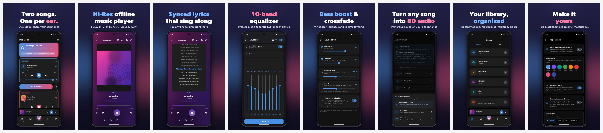
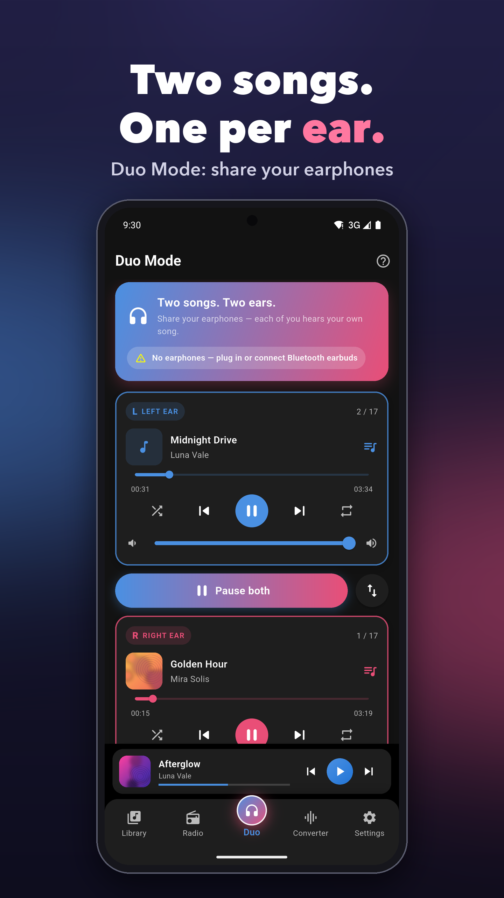
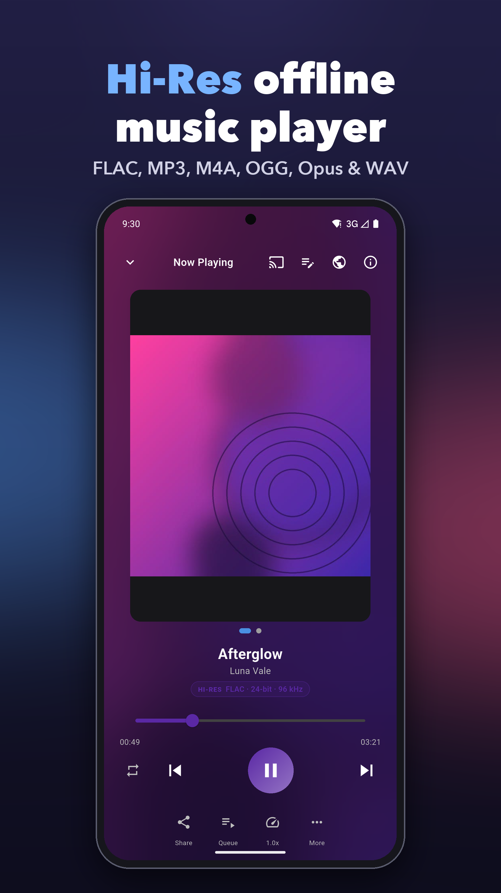
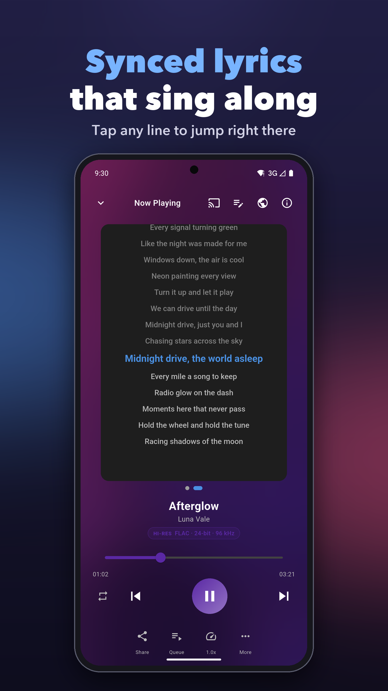
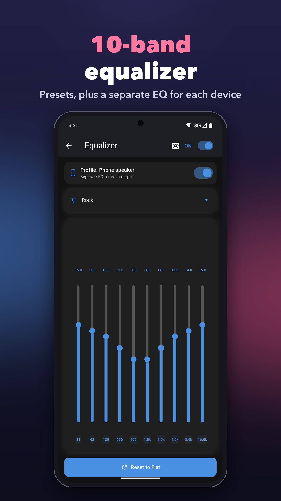
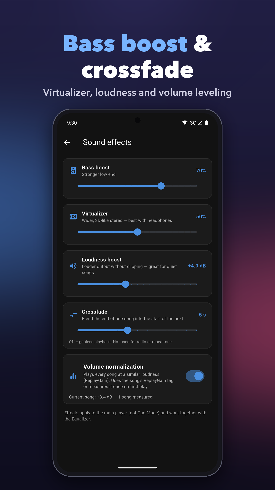
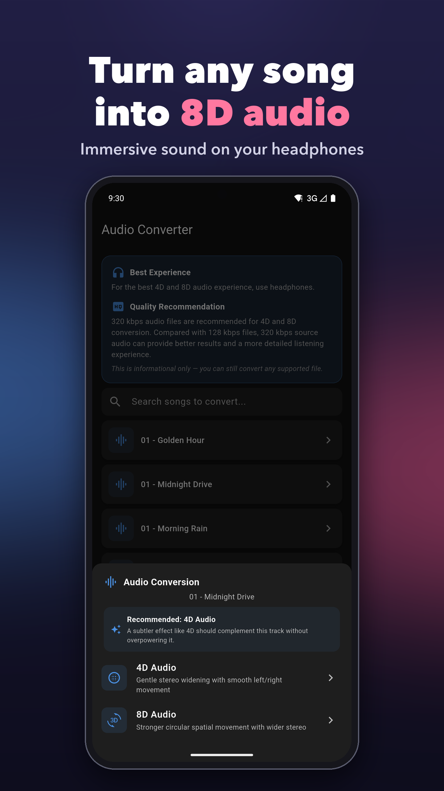
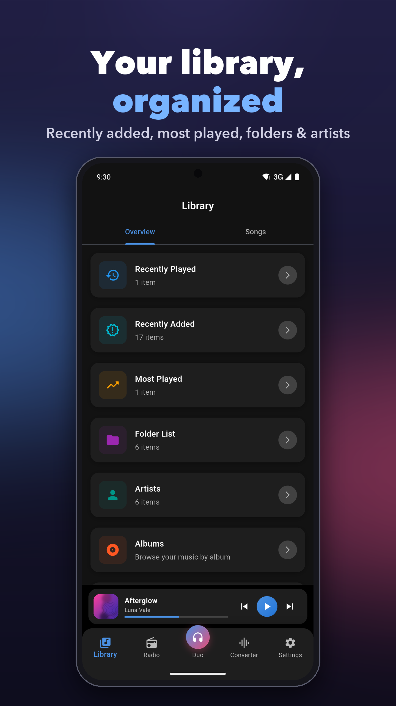
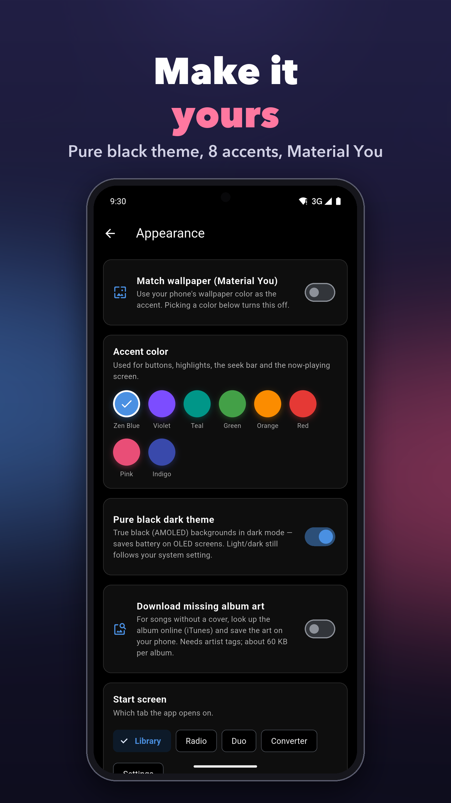

<div align="center">


# Duo Music Player

**A local-first Android music player with real offline 8D/4D audio rendering, Duo Mode (two songs, one pair of earphones), on-device smart features, internet radio and a built-in audio toolkit.**

No account · No ads · No premium tier · No cloud dependency for core playback

[](https://flutter.dev)
[](https://dart.dev)
[](#requirements)
[](https://play.google.com/store/apps/details?id=com.zenocta.duomusicplayer)

</div>



---

## Table of contents

- [Features](#features)
- [Screenshots](#screenshots)
- [Tech stack](#tech-stack)
- [Architecture](#architecture)
- [Getting started](#getting-started)
- [Release builds & signing](#release-builds--signing)
- [Project structure](#project-structure)
- [Permissions](#permissions)
- [Privacy](#privacy)
- [Testing](#testing)
- [Store assets](#store-assets)
- [Contributing](#contributing)
- [License](#license)

## Features

### Library & playback
- Fast local library scanning through Android's `MediaStore` (indexed, no manual directory crawling), with a recursive filesystem fallback
- Browse by songs, albums, artists, genres, folders, playlists, favorites and recently played
- Background playback with media notification, lock-screen controls and media-session integration (`just_audio` + `audio_service`)
- Custom playlists, multiple queues, shuffle/repeat modes, sleep timer, configurable seek buttons and playback speed
- **Crossfade** between songs (off to 12 s)
- **Audiobook / long-file mode** — remembers and resumes your position in long files (audiobooks, podcasts, DJ mixes, lectures)
- **Library filters** — hide short clips (voice notes, call recordings) and exclude whole folders
- **Android Auto / Wear OS / Assistant** browsing via the MediaBrowser tree
- Home-screen **now-playing widgets** (compact, tile and large) with play/pause/next/previous
- Light/dark theme and appearance customization

### Duo Mode
Two different songs playing **at the same time** — one in the left ear, one in the right — so two people can share a single pair of earphones. Powered by a native `DuoEngine` (two ExoPlayers, each downmixed to mono and routed to one channel) and kept alive by a foreground service so playback continues with the screen off.

### Real audio processing (offline, on-device)
- **4D / 8D spatial audio conversion** — genuine ffmpeg DSP (stereo widening, sine-driven L/R pan LFO, chorus/echo) that renders a *new* file; the original is never touched
- **Audio Cutter** — trim songs with a waveform-driven UI backed by on-device PCM analysis
- **Equalizer** — native multi-band EQ with presets and durable per-output profiles
- **Sound effects** — bass boost, virtualizer (spatial widening), loudness boost and volume normalization
- **Tag editor** — edit metadata with lossless stream-copy writes (audio is never re-encoded; verified before replacing the original)
- **On-device analysis** — BPM, energy and mood via a lightweight DSP heuristic (short-time energy envelope, onset-strength autocorrelation, zero-crossing rate), cached per file

### Smart features (on-device, no cloud calls)
- **Smart Mix** — pick a mood (Energetic / Upbeat / Balanced / Mellow / Chill) and get a ranked playlist scored by tempo/energy distance, boosted by favorites and recents
- **Smart-Tag** — classifies songs with no genre/album/artist metadata into mood-based buckets instead of "Unknown"
- **4D/8D preset recommendation** — suggests whether 4D or 8D suits a track, with a one-line reason

### Connectivity & extras
- **Internet radio** via the free [Radio-Browser](https://www.radio-browser.info/) API, with station favorites
- **Chromecast** playback using the Default Media Receiver (no receiver registration needed)
- **Last.fm scrobbling** (optional, bring your own API key — see [Last.fm setup](#lastfm-scrobbling-optional))
- URL-based MP3 downloader
- Manual lyrics paste/storage per song plus an online lyrics search shortcut
- Set any local file as a ringtone
- **Backup & Restore** — export playlists, lyrics, favorites and the conversion cache to a JSON file and restore later
- In-app "What's new" sheet and Play in-app updates

### Free, forever
Every feature — including 4D/8D conversion — is available to everyone. There are no ads and no in-app purchases.

## Screenshots

| Duo Mode | Now Playing | Lyrics | Equalizer |
|:---:|:---:|:---:|:---:|
|  |  |  |  |

| Sound Effects | 8D Audio | Library | Appearance |
|:---:|:---:|:---:|:---:|
|  |  |  |  |

## Tech stack

| Concern | Library / tool |
|---|---|
| Framework | Flutter (Dart `^3.8.1`) |
| Playback | `just_audio`, `just_audio_background`, `audio_service`, `audio_session` |
| Local storage | `hive` / `hive_flutter`, `shared_preferences` |
| Audio DSP | `ffmpeg_kit_flutter_new_audio` (LGPL-only, audio-focused build; maintained successor of the retired `arthenica/ffmpeg-kit`) |
| Metadata | `audio_metadata_reader` |
| Library access | `photo_manager`, native `MediaStore` channel |
| Networking | `dio` (radio streaming, downloads) |
| UI / state | `provider`, `shimmer`, `palette_generator`, `audio_video_progress_bar` |
| Widgets | `home_widget` + native `AppWidgetProvider` |
| Sharing / misc | `share_plus`, `url_launcher`, `permission_handler`, `package_info_plus`, `in_app_update`, `crypto` |
| Native (Kotlin) | ExoPlayer/Media3, Android audiofx, MediaRouter (Cast) |

## Architecture

Flutter UI and services sit on top of a handful of native Android method channels:

```
┌──────────────────────────── Flutter (Dart) ────────────────────────────┐
│  Pages (songs, player, duo, radio, settings …)                           │
│  Services (library, analysis, conversion, smart mix, backup, lastfm …)   │
│  just_audio + audio_service  ← single source of truth for queue/session  │
└───────────────┬──────────────────────────────────────────────────────────┘
                │ MethodChannels
┌───────────────▼──────────────── Android (Kotlin) ───────────────────────┐
│  MainActivity        ringtone, MediaStore scan, Downloads publishing     │
│  EqEngine            equalizer ("music_app/equalizer")                   │
│  DuoEngine           two ExoPlayers → left / right ear                   │
│  DuoPlaybackService  foreground service for Duo Mode                     │
│  CastHelper          Chromecast discovery + playback ("music_app/cast")  │
│  TagWriteHelper      scoped-storage write access for tag editing         │
│  NowPlayingWidget*   home-screen widgets                                 │
└──────────────────────────────────────────────────────────────────────────┘
```

Design notes:
- The main `just_audio` player remains the single source of truth for the queue, notification, widget, EQ and UI; features like crossfade layer on top rather than replacing it.
- Destructive operations (conversion, tag writes) always work on a copy, verify it, and only then replace or publish.
- Pure logic (e.g. Android Auto browse tree, Smart Mix scoring) is kept free of platform code so it is unit-testable.

## Getting started

### Requirements
- Flutter SDK (stable) with Dart `^3.8.1`
- Android Studio / Android SDK (compileSdk & targetSdk 36, **minSdk 24 / Android 7.0+**)
- JDK 17
- A physical Android device is recommended (audio effects, Cast, Duo Mode and widgets don't work well on emulators)

### Run

```bash
git clone https://github.com/zenoctasolutions/duo-music-player.git
cd duo-music-player
flutter pub get
flutter run
```

A debug build (`flutter build apk --debug`) works without any signing configuration.

### Last.fm scrobbling (optional)
Scrobbling is disabled until you supply your own credentials from <https://www.last.fm/api/account/create>. Inject them at build time rather than committing them:

```bash
flutter run --dart-define=LASTFM_API_KEY=your_key --dart-define=LASTFM_SECRET=your_secret
```

## Release builds & signing

Release builds read signing details from `android/key.properties` (gitignored), which points at your keystore:

```properties
storePassword=<store password>
keyPassword=<key password>
keyAlias=<alias>
storeFile=<path to keystore .jks>
```

Then:

```bash
flutter build appbundle --release          # Play Store
flutter build apk --release --split-per-abi
```

> Never commit keystores (`*.jks`, `*.keystore`), `key.properties`, or `local.properties`. They are already listed in `.gitignore`.

## Project structure

```
duo-music-player/
├── lib/                    Dart source (UI pages + services)
├── android/                Android host app
│   └── app/src/main/
│       ├── kotlin/com/zenocta/duomusicplayer/   native engines & helpers
│       └── res/            layouts, widgets, icons
├── images/                 bundled app assets
├── store_assets/           Play Store icon, feature graphic, screenshots + generator scripts
├── test/                   unit & widget tests
├── ios/ macos/ linux/ windows/ web/   Flutter platform scaffolding (Android is the supported target)
└── pubspec.yaml
```

Key files under `lib/`:

| Area | Files |
|---|---|
| Library & UI shell | `songs_page.dart`, `list_page.dart`, `albums_page.dart`, `artists_page.dart`, `genres_page.dart`, `playlist_page.dart`, `library_service.dart`, `media_store_service.dart`, `library_filters_page.dart` |
| Player | `player_screen.dart`, `queue_manager.dart`, `queues_sheet.dart`, `crossfade_service.dart`, `position_memory_service.dart` |
| Duo Mode | `duo_page.dart`, `duo_service.dart` |
| Audio processing | `audio_conversion_service.dart`, `audio_conversion_sheet.dart`, `audio_cutter.dart`, `audio_cutter_service.dart`, `audio_effects_service.dart`, `equalizer_screen.dart`, `eq_profile_service.dart`, `waveform_service.dart` |
| Smart features | `audio_analysis_service.dart`, `smart_mix_service.dart`, `smart_mix_page.dart`, `preset_recommender.dart` |
| Metadata & lyrics | `tag_editor_page.dart`, `tag_editor_service.dart`, `lyrics_service.dart`, `local_lyrics.dart`, `online_lyrics.dart`, `artwork_service.dart` |
| Connectivity | `radio_service.dart`, `radio_page.dart`, `cast_service.dart`, `cast_sheet.dart`, `lastfm_service.dart`, `lastfm_page.dart`, `url_download_screen.dart` |
| System integration | `auto_browse.dart`, `home_widget_service.dart`, `ringtone_screen.dart`, `backup_service.dart`, `app_update_service.dart` |
| Settings & theming | `settings_page.dart`, `appearance_page.dart`, `theme_provider.dart`, `app_palette.dart` |

## Permissions

| Permission | Why |
|---|---|
| Audio / storage read | Scan and play your local music |
| Notifications & foreground service | Media notification and Duo Mode playback |
| Internet | Radio, URL downloads, optional Last.fm and lyrics search |
| Write settings | Set a song as ringtone (user initiated) |
| Modify audio settings | Equalizer and sound effects |
| Write access (system prompt per file) | Tag editing on files the app doesn't own |

## Privacy

- Your library, playlists, lyrics and analysis results stay **on your device**.
- No analytics, no ads, no account.
- Network use is limited to features you explicitly use: internet radio, URL downloads, online lyrics search and (optionally) Last.fm scrobbling. Last.fm sign-in stores only the session key, never your password.

## Testing

```bash
flutter analyze
flutter test
```

Unit tests cover library logic, Android Auto browsing and the smart/analysis tiers (`test/`).

## Store assets

`store_assets/` holds the icon set, feature graphic and phone screenshots plus the Python scripts used to generate them (`generate_icon_3d.py`, `make_feature_graphic.py`, `compose_screenshots.py`, `make_demo_library.py`). The generated demo audio library is gitignored and can be recreated with `make_demo_library.py`.

## Contributing

Issues and pull requests are welcome.

1. Fork the repo and create a feature branch: `git checkout -b feature/my-change`
2. Keep changes focused; run `flutter analyze` and `flutter test` before opening a PR
3. Describe what changed and why in the PR description

## License

Copyright © Zenocta. All rights reserved. No open-source license is granted at this time; contact the maintainers for usage permissions. FFmpeg is used under the LGPL via `ffmpeg_kit_flutter_new_audio`.

---

<div align="center">

Made by **Zenocta** · [Get it on Google Play](https://play.google.com/store/apps/details?id=com.zenocta.duomusicplayer)

</div>
